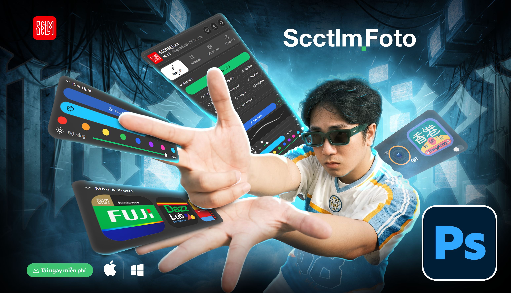
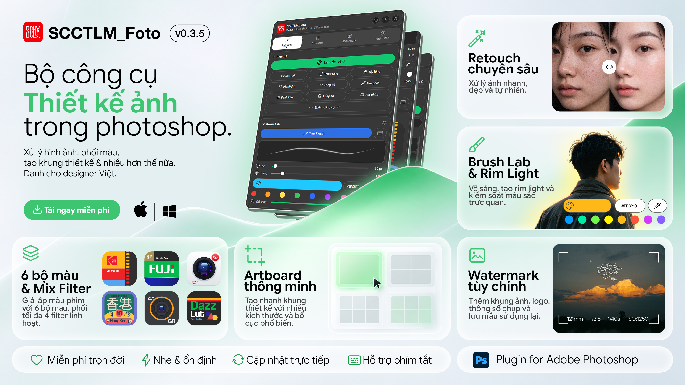

# 🎨 SCCTLM_Foto

**Panel retouch cho Adobe Photoshop — giao diện 100% tiếng Việt**

**SCCTLM_Foto** (_Sáng chơi chữ · Tối làm màu_) là CEP Extension cho Photoshop, gom quy trình làm đẹp chân dung, ảnh cưới, thời trang và thumbnail vào một panel 4 tab: **Retouch**, **Artboard**, **Khám phá**, **Ủng hộ**.

### 🎬 Video giới thiệu

## ✨ Tính năng

- **Retouch** — Làm da, Son môi, Trắng răng, Tẩy lông, Highlight, Lông mi, Phủ phấn, Đánh khối, Trắng da, Hạt phim. Mọi thao tác tạo layer/mask riêng, không phá huỷ ảnh gốc; chạy trên RGB 8/16-bit.
- **Brush Lab** — bật Shape Dynamics + Pen Pressure bằng một nút; chỉnh Cỡ, Cứng, màu cọ và Độ sáng ngay trên panel.
- **Rim Light** — nút **Tạo Rim Light**; khi ảnh có nhóm `Rim Light` > lớp `Color` thì chọn màu (hex, hút màu, 8 màu mẫu) và Độ sáng.
- **Màu & Preset** — 6 bộ màu MHK (165 màu): bấm để áp, hoặc **Mix** tối đa 4 màu. File `.xmp` đặt vào `presets/` tự thành nút.
- **Artboard** — 27 mẫu album Facebook MHK, khổ YouTube hoặc khổ tuỳ chỉnh, kèm guide vùng an toàn.
- **Watermark** — đọc EXIF của ảnh đang mở rồi thêm watermark theo hai chế độ: **Mẫu gốc** (54 mẫu Xiaomi Leica, chỉnh tên máy, địa chỉ, ISO, logo hãng, bố cục, nền) hoặc **Tự tạo** (3 kiểu khung, bo góc, logo, chọn thông số, font, canh chữ, màu nền, xem trước, lưu mẫu). Vẽ lại trên ảnh đã có watermark sẽ hỏi gỡ bản cũ. Mẫu gốc dùng font MiSans, LG1056, Oxanium: cài bằng `scripts/install-watermark-fonts.ps1` nếu có thư mục `fonts/`.
- **Khám phá** — playlist YouTube SCCTLM và link cộng đồng ngay trong panel.
- **Phím tắt Action** — gán F2–F12 (kèm Shift/Ctrl) cho nút **Tạo Brush** / **Tạo Rim Light**.
- **Cập nhật một chạm** — nút **⤓** tải bản mới từ GitHub, kiểm chữ ký Ed25519 trước khi cài. Nút **↻** nạp lại panel.
- **Chạy cục bộ** — không gửi ảnh hay dữ liệu cá nhân; chỉ kết nối GitHub (cập nhật) và YouTube (tab Khám phá).

## 💻 Yêu cầu

Photoshop CC 2015 trở lên · Windows 10/11 (64-bit) hoặc macOS 10.13+ · ảnh chế độ RGB.

## 🚀 Cài đặt

**Windows:** đóng Photoshop → chạy `install\Cai-dat-SCCTLM_Foto.bat` → mở Photoshop → **Window > Extensions > SCCTLM_Foto**.

**macOS:** đóng Photoshop → mở Terminal, chạy `bash install/Cai-dat-SCCTLM_Foto.command` (hoặc nhấp đúp file đó trong Finder; nếu macOS chặn thì chuột phải → **Open**) → mở Photoshop → **Window > Extensions > SCCTLM_Foto**.

> ⚠️ Panel chưa ký số nên script bật `PlayerDebugMode` — cho phép **mọi** extension CEP chưa ký chạy trên tài khoản đó. Tắt lại khi gỡ cài đặt.
> Panel không đóng gói ZXP: ZXP đã ký sẽ hỏng chữ ký khi nút cập nhật ⤓ ghi đè file, nên bản phát hành cài bằng script; bản cập nhật trong panel đã được kiểm chữ ký Ed25519 trước khi cài. Gặp lỗi cài đặt thì bấm **Chẩn đoán** ở cuối panel.

🍎 Cài thủ công

1. Bật `PlayerDebugMode`:
   - Windows: nhấp đúp `install\Fix-CEP-SCCTLM_Foto.reg`.
   - macOS: `for n in 9 10 11 12 13 14 15; do defaults write com.adobe.CSXS.$n PlayerDebugMode 1; done`
2. Chép thư mục plugin vào:
   - Windows: `%APPDATA%\Adobe\CEP\extensions\SCCTLM_Foto\`
   - macOS: `~/Library/Application Support/Adobe/CEP/extensions/SCCTLM_Foto/`
3. Mở Photoshop → **Window > Extensions > SCCTLM_Foto**.

> 🍎 **Mac chip Apple Silicon (M1/M2/M3…) gặp lỗi?** Bật **Rosetta**: Finder → Applications → Photoshop → chuột phải **Get Info** → tick **Open using Rosetta**, rồi mở lại Photoshop. Nếu máy chưa cài Rosetta: `softwareupdate --install-rosetta --agree-to-license`.

**Gỡ cài đặt:** Windows chạy `install\Go-cai-dat-SCCTLM_Foto.bat`, macOS chạy `bash install/Go-cai-dat-SCCTLM_Foto.command` (cả hai hỏi trước khi xoá và tắt `PlayerDebugMode`).

## 🛠️ Xử lý sự cố

| Triệu chứng | Cách xử lý |
|---|---|
| Panel không có trong **Window > Extensions** | Windows: nhấp đúp `install\Fix-CEP-SCCTLM_Foto.reg`. macOS: chạy lại `bash install/Cai-dat-SCCTLM_Foto.command`. Rồi khởi động lại Photoshop. |
| Panel báo *"Ảnh chưa ở chế độ màu RGB"* | Vào `Image > Mode > RGB Color` rồi bấm lại. |
| Panel báo lỗi nhưng chưa rõ cách xử lý, hoặc plugin không khởi động | Bấm **Chẩn đoán** ở cuối panel → **Sao chép báo cáo** rồi gửi cho SCCTLM. Báo cáo không chứa tên người dùng Windows hay ảnh của bạn. |
| Không thấy màu Rim Light | Bấm **Tạo Rim Light** trên ảnh đang mở; phần màu chỉ hiện khi có nhóm `Rim Light` > lớp `Color`. |
| Gán phím F2–F4 bị Photoshop hỏi *"Remove the conflicting action shortcuts?"* | Chọn **No** để phím chạy Action. |

## 📚 Tài liệu

[Lịch sử thay đổi](docs/project-changelog.md) · [Cấu trúc mã nguồn](docs/codebase-summary.md) · [Phát hành & cập nhật](docs/deployment-guide.md) · [Quy chuẩn giao diện](docs/design-guidelines.md)

## ⚖️ Bản quyền

Mã do **hongducdev** viết giữ bản quyền theo [`LICENSE`](LICENSE) (All rights reserved). Một số file `jsx/` có nguồn gốc từ plugin gốc, không thuộc phạm vi `LICENSE` và đang được viết lại theo quy trình clean-room — xem [`NOTICE.md`](NOTICE.md).

## ♡ Ủng hộ

Nếu SCCTLM_Foto giúp ích cho công việc của bạn, hãy đồng hành cùng SCCTLM:

**TPBank** · TRAN THI THUONG · `9897.6386.789`

**Techcombank** · NGUYEN HONG DUC · `3886.0510.2002`

### 🙏 Cảm ơn người đã ủng hộ

<table>
  <tr>
    <td align="center" width="140">
       
      <a href="https://www.facebook.com/NguyenThanhLam.02"><b>Nguyễn Thành Lâm</b></a>
    </td>
    <td align="center" width="140">
       
      <a href="https://www.facebook.com/long.truong.7712"><b>Long Trương</b></a>
    </td>
  </tr>
</table>
